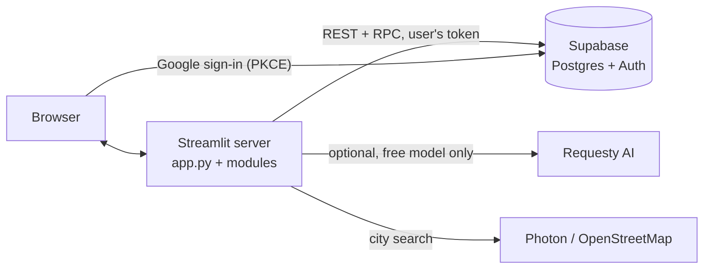

# How Life Quest is built

A guide for the repository walkthrough. Every team member should be able to explain each section.

## 1. The big picture

Life Quest is a **Streamlit** app (Python). Streamlit runs the Python code on a server and sends the finished page to the browser; every click re-runs the script from the top. All data lives in **Supabase** (hosted PostgreSQL + login). The app talks to Supabase over its REST API with the user's own login token, so the database's security rules apply to every request.

## 2. Where the code is

| File | What it does |
|---|---|
| `app.py` | Entry point: login/sign-up, Supabase requests (`api_request`), dashboard, navigation, Settings |
| `onboarding.py` + `onboarding_text.py` | First-run questions (nickname, pillars (all seven available), starting levels, quests shown, city) and their translations |
| `ai_quest_ui.py` | Home, pillar and Recap pages: loading, completing and replacing quests, statistics, CSV export |
| `quest_plan.py` | Pure logic: the 5 habit tracks per pillar, difficulty progression, statistics, weekly recap, CSV export, adaptivity hint |
| `ai_quests.py` | Optional AI wording of quests, with strict checks on every answer |
| `social_play.py` | Squads, shared squad quests, weekly squad ranking, 1v1 competitions |
| `profile_data.py` + `personalization.py` | Profile settings, country/city and language preferences |
| `account.py` | Profile photo, avatar ring, phone/laptop notifications |
| `places.py` | City search with the free Photon (OpenStreetMap) API |
| `i18n.py` | Shared translations and the language picker |
| `design.py` + `.streamlit/config.toml` | The whole visual design: theme, CSS, reusable HTML pieces (see `docs/design.md`) |
| `auth_helpers.py`, `auth_component/` | Login helpers and the Google sign-in button (PKCE flow) |
| `supabase/*.sql` | Tables, security rules and database functions |
| `tests/` | Automated tests (section 6) |

## 3. Where the data is stored

**Supabase PostgreSQL** (application tables protected by Row Level Security):

| Data | Table(s) |
|---|---|
| Profile: name, city, chosen pillars, XP, email reminders | `profiles` |
| The user's quests (active, completed, skipped, feedback) | `ai_quests` |
| Original shared challenges and their completions | `challenges`, `completed_challenges` |
| Squads and members | `squads`, `squad_members` |
| Weekly squad quests and confirmations | `squad_quests`, `squad_confirmations` |
| 1v1 competitions | `friend_duels`, `duel_days`, `duel_scores`, `duel_weeks` |
| XP awarded for social activity | `social_rewards` |

**Supabase Auth user metadata** (a small JSON document attached to each login), for per-user settings that did not need new tables:
`lifequest_onboarding` (answers, starting levels, quests shown per pillar), `lifequest_preferences` (target language; an older session-length value is kept but no longer asked), `lifequest_language` (UI language), `lifequest_profile` (photo, avatar ring, notification preference).
*Why:* the shared database was already set up, and adding columns means a migration for the whole team. *Limit:* the user can write their own metadata, so it must never decide anything security-relevant (see section 5).

**Streamlit session state** (server memory, per browser tab): the login token and the current page. `browser_session.py` stores only the rotating refresh token in project-scoped localStorage for at most 30 days since an authenticated renewal, with a sessionStorage fallback. It restores and verifies identity with Supabase after reload or reopening the app. Logout clears both stores, notifies other tabs, and revokes the session. Private browsing or blocked storage can limit persistence. This is a browser credential, so script-injection prevention remains essential.

**Secrets** (Supabase URL/key, AI key) live in Streamlit Secrets: `.streamlit/secrets.toml` locally (git-ignored) and the deployment's Secrets settings online. They are never in the repository.

## 4. Main workflows

1. **Sign up / log in**: email + password (validated in the app, then Supabase Auth) or Google (PKCE, verified by Supabase).
2. **Onboarding**: answers are saved to user metadata, a profile row is created, and five quests per pillar are prepared.
3. **Complete a quest**: ticking the box calls the database function `save_quest_slots`, which in **one transaction** marks it done, awards XP and stores the next quest. If anything fails, nothing is half-saved.
4. **Progression**: `quest_plan.slot_plan` makes the next quest a bit harder after a success and easier after "too hard", within fixed limits.
5. **Squads**: create or join with an invite code; shared quests need two confirmations; the Squad page ranks members by this week's XP.
6. **Weekly recap**: quests and XP since Monday vs last week, a per-pillar breakdown, the best day, and a CSV export including personal quests, multiplayer completions and XP bonuses. Exact awarded XP is recorded separately from nominal points; weekly bonuses add XP without counting as extra quests.
7. **Settings**: pillars, quests shown per pillar, photo, avatar rings, language and scheduled email preferences. City and target language are chosen in onboarding.

Each quest whose target changed since the last time shows a small line such as "↑ up from 4,000 last time", which makes the adaptive difficulty visible.

## 5. Security

- **Credentials**: none in the repository (a test scans for them). `.streamlit/secrets.toml` is git-ignored.
- **Access control**: Row Level Security on every table; users can only read and change their own rows. Anything that awards XP runs in `security definer` database functions that check `auth.uid()`; the app cannot just "add points".
- **XP protection**: `supabase/protect-profile-points.sql` limits which profile columns users may write, so XP cannot be edited directly through the API.
- **Security audit**: `docs/security-audit.md` lists every finding, its severity and fix. `supabase/security-hardening.sql` closes the database ones (squads only joinable with a code, daily XP cap, length limits).
- **Errors and names**: database errors are replaced by friendly messages, and other users' names are shown as plain text (no Markdown links or images).
- **Input validation**: email format, password ≥ 8 characters and matching, nickname ≤ 30, squad name 2–50, city search ≤ 80 characters, photo type and size (≤ 8 MB, re-encoded to 80×80 JPEG), and every AI answer is checked (`validate_batch`) before use.
- **Output safety**: user text is HTML-escaped before it is shown in custom HTML, and CSV exports neutralise cells starting with `= + - @` so a spreadsheet never runs them as formulas (CSV injection).
- **Dependencies**: three direct dependencies (`streamlit`, `pillow`, `pytest` for tests), pinned to exact versions in `pyproject.toml`/`uv.lock`/`requirements.txt`, and checked with `pip-audit` on every push.

**Known limits** (say these honestly if asked):
- The profile photo is stored in user metadata (small, but it travels with the login token). A Supabase Storage bucket would be the proper home.

## 6. Tests

Run: `uv run pytest` (Python) and `node --test tests/*.test.cjs checks/*.test.cjs` (Google sign-in). GitHub Actions runs both, plus a dependency audit, on every push (`.github/workflows/tests.yml`).

| File | Covers |
|---|---|
| `test_auth.py` | Email validation, resend cooldown, safe redirect URLs, error messages, Google identity checked with the server |
| `test_quest_logic.py` | Starting targets, progression after success / "too hard", limits, statistics, streaks, titles |
| `test_ai_quests.py` | Accepted and rejected AI answers (13 kinds of bad output), free-model check, network failures |
| `test_features.py` | City search (results, too-short and long queries, service down), all-pillar availability, photo processing, HTML escaping |
| `test_app_screens.py` | The real app starts; missing configuration message; login and sign-up reject bad input; Supabase unreachable |
| `test_recap_and_text.py` | Weekly recap (week boundaries, XP, per pillar), CSV export (order, formula neutralising), adaptivity hint, and that all four languages have every text |
| `test_security.py` | No committed credentials; secrets file ignored; XP not user-writable |
| `test_workflows.py` + `fake_supabase.py` | **19 end-to-end workflows** on the real app against an in-memory Supabase: sign-up and onboarding, nickname required, all seven pillars, wrong password, completing a quest (XP, refill, harder next target, hint shown), quests shown per pillar, recap, squads (create, join, wrong code, too-short name, two confirmations = 30 XP each), Settings (quests per pillar, add a pillar, all-pillar availability, city saved once), logout ends the session, Markdown in names shown as text |
| `oauth.test.cjs` | PKCE, replayed or foreign messages, expired verifier, failed exchange |

**Not covered automatically:** the real SQL functions and RLS policies (the fake follows their rules but is not Postgres), the visual design, the quality of AI wording, browser notifications and real emails. These were checked by hand (see the demo checklist below).

## 7. When something it depends on is unavailable

Every service the app calls, and what happens when it fails. We check this list before each demo.

| Service | Used for | If it is down or over its limit |
|---|---|---|
| Streamlit Community Cloud | Hosting the app | The app is unreachable. A free app that has not been used for a while "sleeps" and takes up to a minute to wake: open the URL before presenting. |
| Supabase (database + Auth) | Accounts, quests, XP, squads | A clear "could not be reached… check your internet connection" message instead of a crash (tested). Google sign-in is disabled rather than broken. A free project pauses after a long time unused: open the dashboard the day before. |
| Google sign-in (through Supabase) | "Continue with Google" | The button is disabled with "Google sign-in is not configured for this app address"; email login still works. |
| Requesty AI: quest wording | Wording new quests | Quests come from the built-in habit library, with a small note saying so. Only zero-cost models are used. Free limits are hit by several requests at once, so the library is also the fallback then. |
| Requesty AI: reflections | The progress card's short reflection | A local encouragement, clearly labelled "AI reflection is temporarily unavailable". |
| Requesty AI: translation | Translating AI-worded quests | The original text stays visible with a note; tasks and progress are unchanged. Library quests are translated locally and never need AI. |
| Photon / OpenStreetMap | City search | "City search is unavailable right now…". The city is optional, and failures are not cached, so it works again as soon as the service is back. |
| Brevo (email) | Confirmation and reminder emails | Sign-up still succeeds; the user can resend the confirmation after 60 seconds. Refused reminders are retried up to three times; unclear failures are not retried, to avoid duplicates. |
| GitHub Actions | Hourly reminder and weekly-prize job | Reminders arrive late. Weekly prizes are also settled when the Leaderboard is opened, so they catch up. |
| Google Fonts | The Inter Tight font | The browser uses its normal sans-serif font. |
| Browser notifications | Device test notification | The button explains why it is unavailable (for example, iPhone needs the app on the Home Screen). |

## 8. How it could change

- Photos in Supabase Storage.
- Run the `supabase/check-*.sql` database tests automatically in CI against a local Supabase.
- Switch to a free AI model that keeps no data and does not train on it (see [verification.md](verification.md)).
- An in-app button to delete your account, instead of an email request.

## 9. Demo checklist (before presenting)

1. Open the deployed URL in a private window; sign up with a new email; finish onboarding (choose any available pillars and a target language when selecting Languages).
2. Complete a quest on Home: it fades, XP goes up, a new quest appears.
3. Open a pillar page: stats, 14-day activity, "Where you can grow next".
4. Squad: create a squad, show the invite code and weekly ranking.
5. Recap: show the week's numbers and download the CSV.
6. Settings: change quests per pillar, search a city, upload a photo, pick an avatar ring.
7. Show invalid input: wrong email on login, short password on sign-up.
8. Show the green "Tests" check on GitHub.

## Recent authentication and testing improvements

- Google OAuth uses PKCE and passes session tokens to the Streamlit application.
- The application stores refresh tokens and attempts token renewal when a session approaches expiry.
- API errors are converted to user-friendly messages without exposing raw database details.
- `tests/test_token_refresh.py` covers token rotation and refresh failures.
- `tests/test_api_errors.py` covers malformed responses and safe error messages.
- Current totals: 238 Python tests and 8 JavaScript tests, all passing on `main`.

### Security checks on the live database

Passing app tests does not prove the real database is secure, so we also ran the `supabase/check-*.sql` scripts against the live project. They create made-up users, assert that Row Level Security, permissions and the XP functions behave as intended, and roll everything back (48 checks, all passed). Details: [verification.md](verification.md).

### Quest display languages

`quest_languages.py` translates all habit-library title variants, shared squad
quests and duel score units locally (English, Portuguese, French and German).
`quest_display.py` applies the selected language on every render, including
existing active quests, growth suggestions, completion history and CSV quest
titles. IDs, targets, XP and stored history are never changed by a language switch.
Custom AI titles use the same verified zero-cost Requesty model for translation,
with cached results and numeric-target validation. If that service is unavailable,
the original custom text remains visible with a translated explanation; a different
task is never silently substituted. Translation sends only quest text, not profiles.

## Product fixes and scheduled background work (23 November)

`supabase/product-fixes.sql` wraps the existing completion transaction to record exact XP and a personalisation context snapshot; numeric progression and same-day replacement are unchanged. `get_activity_history` includes social rewards, while the member-only squad leaderboard uses stable user IDs. Members can leave squads; pending duels can be declined or cancelled, and active duels end after the current UTC day so today's score remains fair. Social screens refresh every 30 seconds.

Six navigation destinations: Home, Recap, Squad, Competition, Leaderboard and Settings. Pillar pages open within Home. Greeting XP renders after completion processing.

`session_component/` implements the remembered sign-in (up to 30 days, verified by Supabase on every restore; see section 3). `scripts/send_reminders.py`, `supabase/reminders.sql` and `.github/workflows/reminders.yml` implement opt-in localized email and competition settlement. See [reminders.md](reminders.md) for permissions, quotas, retry semantics and operational limits.

`tests/test_product_fixes.py` covers exact recap XP, preserved progression, preferences, navigation, squad leave, session identity checks and no-send SMTP checks. `tests/session.test.cjs` covers storage rotation, logout, project scoping and foreign-message rejection. Fake API tests do not establish real database correctness; live SQL checks are separate.

### Variety, feedback and invitation links

`quest_variety.varied_plan` wraps the unchanged `slot_plan`, selecting a variant absent from the recent per-slot history and recording its index/version in the existing quest context. `render_variant` uses local translations and saved preferences for both active and completed library quests. AI-generated text keeps its own wording; a normalized recent-title check rejects exact and number-only repeats. No schema change is required.

`progress_insights` uses UTC completion dates, excluding active/skipped/future rows and weekly XP bonuses. Its most consistent track is selected by distinct active days, then completions; language tracks are separated by saved target language. Comparisons stop at the same weekday in each week.

`invitations` validates hexadecimal squad/competition codes and builds links only from a validated configured app URL. Pending invitations survive email login and the Google PKCE browser handoff. They remain inert until an authenticated explicit acceptance calls the existing join RPC; the database continues to enforce membership, recipient and closed-invitation rules. Copying uses Streamlit's native copy control. `checks/` covers these journeys, factual calculations, all local variants and the OAuth handoff.

## Multiplayer and weekly ranking revision (23 November)

`supabase/weekly-leaderboard.sql` is applied after `reminders.sql` and `product-fixes.sql`. It preserves the legacy ranking API and adds authenticated `get_global_weekly_ranking`. The response exposes only nickname, validated avatar data, stable user ID and current weekly activity XP. Every profile appears, including zero-XP accounts. Prize eligibility requires positive weekly XP.

Weeks are Monday–Sunday UTC. The existing hourly restricted worker settles all social results before ranking the closed week. Winners receive 100/50/25 lifetime XP exactly once through private prize/event records. Ties use quest count, then earlier last XP event, then stable ID. Prize XP is excluded from later weekly rankings. Duel day/week XP belongs to the completed activity week even when settled after midnight. Season activation prevents retroactive prizes for weeks before installation. Week settlement also runs when the leaderboard is opened, so a delayed scheduler can catch up. No client can choose recipients or amounts.

`duel_progress` shows confirmed pair XP and provisional current scores separately. `invitations.normalize_invite_code` identifies the code's actual type, including a pasted link, so a 12-character competition code works from the Squad form too. The join RPC rejects own, closed and wrong-recipient invitations and reuses a previous pair when appropriate.

`habit_journey` supplies broad, translated habit names and first/latest/next target summaries. Long-term milestones are the existing progression ceilings, not a new difficulty policy. AI reflections send only selected activity evidence to the verified zero-cost Requesty model, reject unsupported numeric claims, and use a clearly labeled local fallback when unavailable. Settings keeps saved preferences but omits the city and personalization editors.
