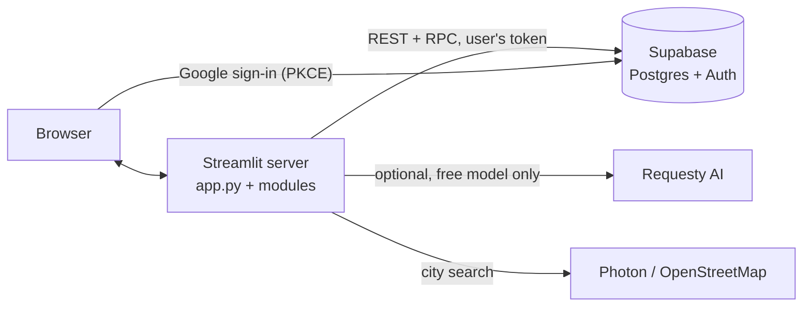

# How Life Quest is built

A guide for the repository walkthrough. Every team member should be able to explain each section.

## 1. The big picture

Life Quest is a **Streamlit** app (Python). Streamlit runs the Python code on a server and sends the finished page to the browser; every click re-runs the script from the top. All data lives in **Supabase** (hosted PostgreSQL + login). The app talks to Supabase over its REST API with the user's own login token, so the database's security rules apply to every request.

## 2. Where the code is

| File | What it does |
|---|---|
| `app.py` | Entry point: login/sign-up, Supabase requests (`api_request`), dashboard, navigation, Settings |
| `onboarding.py` | First-run questions: nickname, pillars (max 3 on free), starting levels, quests shown, city |
| `ai_quest_ui.py` | Home and pillar pages: loading, completing and replacing quests, statistics |
| `quest_plan.py` | Pure logic: the 5 habit tracks per pillar, difficulty progression, statistics |
| `ai_quests.py` | Optional AI wording of quests, with strict checks on every answer |
| `social_play.py` | Squads, shared squad quests, weekly squad ranking, 1v1 competitions |
| `pro.py` | Life Quest Pro (demo subscription): plans, pillar limit, Pro card |
| `account.py` | Profile photo, avatar ring (Pro), phone/laptop notifications |
| `places.py` | City search with the free Photon (OpenStreetMap) API |
| `design.py` + `.streamlit/config.toml` | The whole visual design: theme, CSS, reusable HTML pieces (see `docs/design.md`) |
| `auth_helpers.py`, `auth_component/` | Login helpers and the Google sign-in button (PKCE flow) |
| `supabase/*.sql` | Tables, security rules and database functions |
| `tests/` | Automated tests (section 6) |

## 3. Where the data is stored

**Supabase PostgreSQL** (13 tables, all with Row Level Security):

| Data | Table(s) |
|---|---|
| Profile: name, city, chosen pillars, XP, email reminders | `profiles` |
| The user's quests (active, completed, skipped, feedback) | `ai_quests` |
| Original shared challenges and their completions | `challenges`, `completed_challenges` |
| Squads and members | `squads`, `squad_members` |
| Weekly squad quests and confirmations | `squad_quests`, `squad_confirmations` |
| 1v1 competitions | `friend_duels`, `duel_days`, `duel_scores`, `duel_weeks` |
| XP awarded for social activity | `social_rewards` |

**Supabase Auth user metadata** (a small JSON document attached to each login), for per-user settings that did not need new tables:
`lifequest_onboarding` (answers, starting levels, quests shown per pillar), `lifequest_pro` (Pro status and plan), `lifequest_profile` (photo, avatar ring, notification preference).
*Why:* the shared database was already set up, and adding columns means a migration for the whole team. *Limit:* the user can write their own metadata, so it must never decide anything security-relevant (see section 5).

**Streamlit session state** (server memory, per browser tab): the login token and the current page. Nothing is stored in the browser except the short-lived PKCE code for Google sign-in.

**Secrets** (Supabase URL/key, AI key) live in Streamlit Secrets: `.streamlit/secrets.toml` locally (git-ignored) and the deployment's Secrets settings online. They are never in the repository.

## 4. Main workflows

1. **Sign up / log in**: email + password (validated in the app, then Supabase Auth) or Google (PKCE, verified by Supabase).
2. **Onboarding**: answers are saved to user metadata, a profile row is created, and five quests per pillar are prepared.
3. **Complete a quest**: ticking the box calls the database function `save_quest_slots`, which in **one transaction** marks it done, awards XP and stores the next quest. If anything fails, nothing is half-saved.
4. **Progression**: `quest_plan.slot_plan` makes the next quest a bit harder after a success and easier after "too hard", within fixed limits.
5. **Squads**: create or join with an invite code; shared quests need two confirmations; the Squad page ranks members by this week's XP.
6. **Settings**: pillars (3 free / 7 Pro), quests shown per pillar, city, photo, notifications, Pro.

## 5. Security

- **Credentials**: none in the repository (a test scans for them). `.streamlit/secrets.toml` is git-ignored.
- **Access control**: Row Level Security on every table; users can only read and change their own rows. Anything that awards XP runs in `security definer` database functions that check `auth.uid()`; the app cannot just "add points".
- **XP protection**: `supabase/protect-profile-points.sql` limits which profile columns users may write, so XP cannot be edited directly through the API.
- **Input validation**: email format, password ≥ 8 characters and matching, nickname ≤ 30, squad name 2–50, city search ≤ 80 characters, photo type and size (≤ 8 MB, re-encoded to 80×80 JPEG), and every AI answer is checked (`validate_batch`) before use.
- **Output safety**: user text is HTML-escaped before it is shown in custom HTML.
- **Dependencies**: three direct dependencies (`streamlit`, `pillow`, `pytest` for tests), pinned to exact versions in `pyproject.toml`/`uv.lock`/`requirements.txt`, and checked with `pip-audit` on every push.

**Known limits** (say these honestly if asked):
- Pro is a demo: the Pro flag is in user metadata, which the user can change. A real version would set it from a payment provider's webhook into a table users cannot write.
- The profile photo is stored in user metadata (small, but it travels with the login token). A Supabase Storage bucket would be the proper home.
- The squad ranking matches leaderboard rows to members by display name (the leaderboard function returns no user ids).

## 6. Tests

Run: `uv run pytest` (Python) and `node --test tests/oauth.test.cjs` (Google sign-in). GitHub Actions runs both, plus a dependency audit, on every push (`.github/workflows/tests.yml`).

| File | Covers |
|---|---|
| `test_auth.py` | Email validation, resend cooldown, safe redirect URLs, error messages, Google identity checked with the server |
| `test_quest_logic.py` | Starting targets, progression after success / "too hard", limits, statistics, streaks, titles |
| `test_ai_quests.py` | Accepted and rejected AI answers (13 kinds of bad output), free-model check, network failures |
| `test_features.py` | City search (results, too-short and long queries, service down), Pro limits, photo processing, HTML escaping |
| `test_app_screens.py` | The real app starts; missing configuration message; login and sign-up reject bad input; Supabase unreachable |
| `test_security.py` | No committed credentials; secrets file ignored; XP not user-writable |
| `oauth.test.cjs` | PKCE, replayed or foreign messages, expired verifier, failed exchange |

**Not covered automatically:** the SQL functions and RLS policies against a real database, the logged-in screens end to end, the visual design, and the quality of AI wording. These were checked by hand (see the demo checklist below).

## 7. When something it depends on is unavailable

| Service down | What the user sees |
|---|---|
| Supabase | A clear message ("could not be reached… check your internet connection"); Google sign-in is disabled instead of broken. No crash (tested). |
| Requesty AI (or no key, or rate limit) | Quests come from the built-in habit library; a small note says so. Only zero-cost models are ever used. |
| Photon city search | "City search is unavailable right now. You can skip this…" The city is optional; failures are not cached, so it works again as soon as the service is back. |
| Google Fonts | The browser falls back to its normal sans-serif font. |
| Browser notifications not supported | The notifications button explains why (e.g. iPhone needs the app on the Home Screen). |

## 8. How it could change

- Real payments for Pro (Stripe), with the Pro flag in a server-only table.
- Paid APIs from the "Coming soon" list: country-aware AI, nearby places/events, weather, health/calendar sync, scheduled push notifications (needs a push server).
- Photos in Supabase Storage; leaderboard by user id instead of name.
- Database tests for the SQL functions (e.g. with a local Supabase in CI).

## 9. Demo checklist (before presenting)

1. Open the deployed URL in a private window; sign up with a new email; finish onboarding (pick 3 pillars; try a 4th to show the Pro limit).
2. Complete a quest on Home: it fades, XP goes up, a new quest appears.
3. Open a pillar page: stats, 14-day activity, "Where you can grow next".
4. Squad: create a squad, show the invite code and weekly ranking.
5. Settings: change quests per pillar, search a city, upload a photo, subscribe to Pro (yearly), pick an avatar ring.
6. Show invalid input: wrong email on login, short password on sign-up.
7. Show the green "Tests" check on GitHub.
